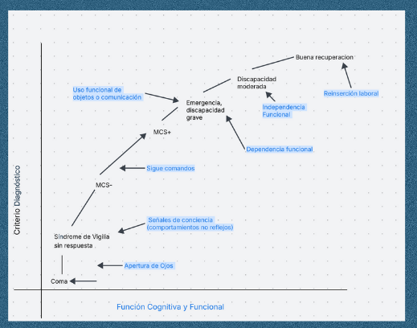

# La recuperación

Escuche la explicación (2 minutos)

<audio controls preload="none" src="medios/recuperacion.mp3"></audio>

## La curva de recuperación

La recuperación del coma sigue un recorrido con niveles **gradualmente crecientes** de funciones conductuales, cognitivas y funcionales (Chatelle y Laureys, 2011).

En el gráfico, cada paso hacia arriba está marcado por un logro:

- **Apertura de ojos:** del coma al síndrome de vigilia sin respuesta.
- **Señales de conciencia** (comportamientos que no son reflejos): estado de mínima conciencia (MCS-).
- **Sigue órdenes simples:** MCS+.
- **Usa objetos o se comunica de forma funcional:** emergencia del estado de mínima conciencia.
- Después, el camino sigue hacia más **independencia funcional** y, en algunos casos, la **reinserción laboral**.

!!! pausa "¿Sabe en qué etapa de la recuperación está la persona que cuida?"
    Lo invitamos a pensar en qué etapa de la recuperación se encuentra la persona que está cuidando.

    Si tiene dudas, **consulte al equipo profesional**.
