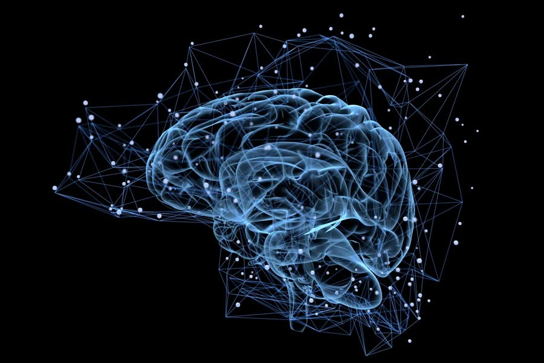

---
hide:
  - toc
---

# Trastorno de conciencia

Qué es, cómo se evalúa, cómo es la recuperación y qué cuidados necesita la persona.

Este módulo tiene **8 temas cortos**. Cada uno combina explicaciones, videos o audios, y al final una pausa para pensar en la persona que usted cuida. En algunos temas hay un pequeño juego de **verdadero o falso**.

1. [¿Qué es un trastorno de conciencia?](01-que-es.md)
2. [¿Cómo se evalúa el estado de conciencia?](02-evaluacion.md)
3. [La recuperación](03-recuperacion.md)
4. [Estimulación multimodal](04-estimulacion.md)
5. [Movilizar y posicionar a la persona](05-movilizacion.md)
6. [Cuidado y protección de la piel](06-piel.md)
7. [Preguntas frecuentes](07-preguntas-frecuentes.md)
8. [Para terminar](08-cierre.md)

[Empezar :material-arrow-right:](01-que-es.md){ .md-button .md-button--primary }
